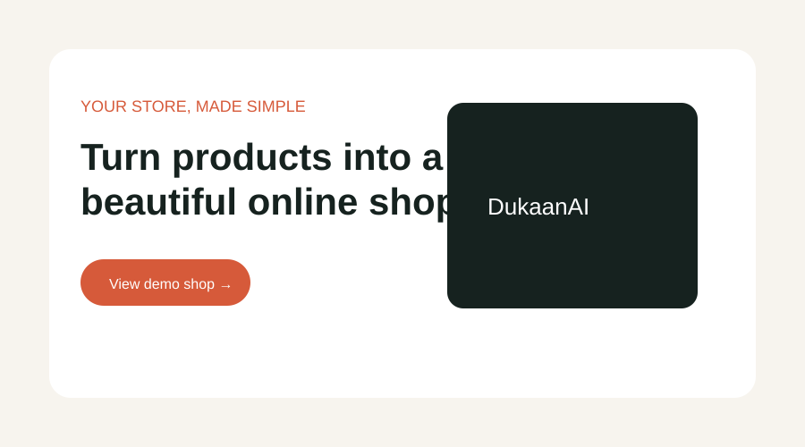
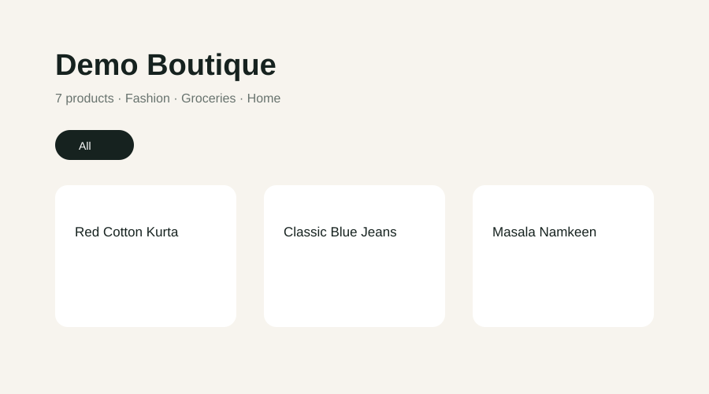

# DukaanAI

DukaanAI is a reproducible starter for a small-business AI commerce assistant.
This scaffold contains a FastAPI backend, a SQLAlchemy persistence foundation,
an extraction pipeline with a deterministic mock/Gemini adapter, and a Vite
React TypeScript shop creation, review, and public catalogue flow.

## Requirements

- Python 3.12.8 (`.python-version`)
- Node.js 22.14.0 (`.nvmrc`)
- Docker and Docker Compose (recommended)

## Local setup

```bash
python -m venv .venv
# Windows: .venv\\Scripts\\activate
# macOS/Linux: source .venv/bin/activate
python -m pip install -r requirements.txt
npm --prefix frontend ci
```

## Run locally

In one terminal:

```bash
uvicorn backend.main:app --reload --port 8000
```

In another:

```bash
npm --prefix frontend run dev
```

Open http://localhost:5173. The page calls `/health`; Vite proxies that request
to the backend at `http://localhost:8000`.

## Use the app

1. Open the home page, enter your shop name and WhatsApp number, then create the shop.
2. Add up to five product photos, describe the products, extract them, review/edit the drafts, and save.
3. Copy the public shop link and share it; customers can browse the catalogue and order on WhatsApp.

## API

- `POST /api/shops` with `{"name":"Demo Mart","whatsapp_number":"+911234"}` creates a shop and unique slug.
- `POST /api/shops/{slug}/extract` accepts 1–5 JPG/PNG/WEBP files under `images` and optional `text`; it returns product drafts without saving them.
- `POST /api/shops/{slug}/products` with `{"products":[...]}` saves reviewed products.
- `GET /api/shops/{slug}` returns the shop and saved catalogue.
- `PUT /api/shops/{slug}/products/{id}` updates a product.
- `DELETE /api/shops/{slug}/products/{id}` deletes a product.

With `MOCK_AI=true`, a complete local extraction request is:

```bash
curl -X POST http://localhost:8000/api/shops \
  -H 'Content-Type: application/json' \
  -d '{"name":"Demo Mart","whatsapp_number":"+911234567890"}'

curl -X POST http://localhost:8000/api/shops/demo-mart/extract \
  -F 'images=@sample_data/tea.png;type=image/png' \
  -F 'text=tea and rice'
```

Extraction is intentionally separate from saving so a future review UI can edit
drafts before calling the products endpoint.

## Test

```bash
make test
```

This runs the backend pytest, frontend Vitest/React Testing Library tests, and a production TypeScript/Vite build. Tests are
offline after dependencies have been installed.

## Docker Compose

```bash
docker compose up --build
```

Open http://localhost:5173 and the API health endpoint at
http://localhost:8000/health. Stop the stack with `Ctrl+C`.

## Demo in 60 seconds

The app is designed to be judge-friendly on a clean machine: no API key is
needed because the deterministic mock extractor is enabled by default.

1. Start the stack with `docker compose up --build`.
2. Open http://localhost:5173 and choose **View demo shop** to browse the
   seeded seven-product catalogue, or create a shop with any name and number.
3. On the manage page choose **Try it with sample photos**, then choose
   **Extract products** and review the generated drafts.
4. Publish the drafts and open the public catalogue link. Customers can use
   the WhatsApp order buttons from the catalogue.

The demo shop is seeded idempotently at backend startup as
`/shop/demo-boutique`. Its images are generated locally and are not fetched
from an external service. To use Gemini instead, set `MOCK_AI=false` and
provide `GEMINI_API_KEY`; if that provider fails, the UI shows an actionable
error and the server remains healthy.





For a clean database reset, run `docker compose down -v` followed by
`docker compose up --build`. The backend repairs the known SQLite schema
upgrade (`products.image_url`) before seeding, so an old local database cannot
prevent startup.
